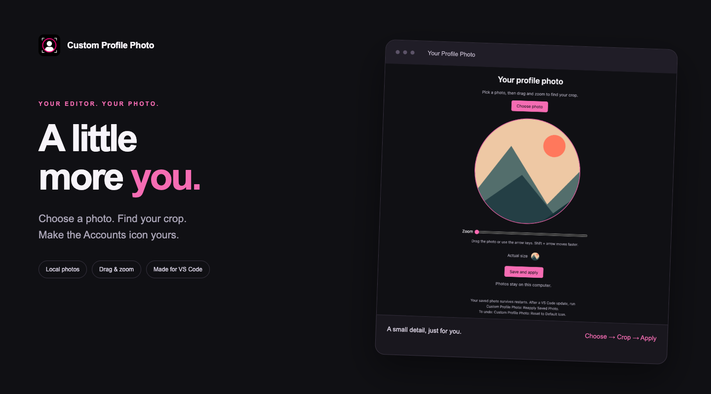
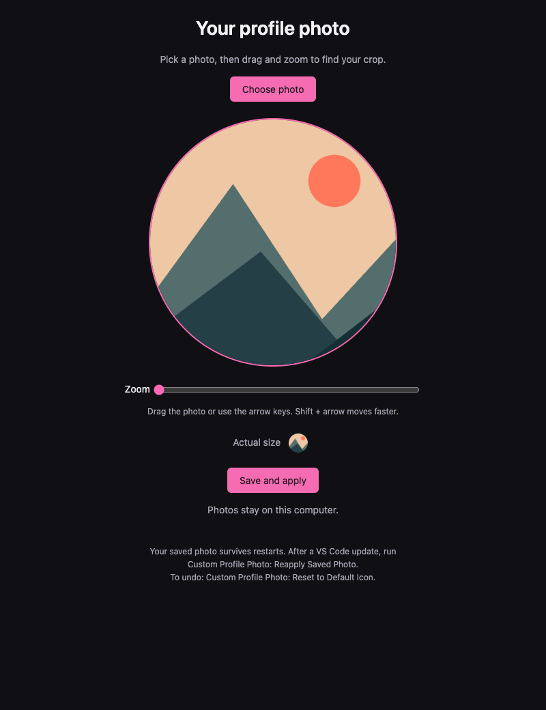

<p align="center">
  
</p>
<h1 align="center">Custom Profile Photo</h1>
<p align="center"><strong>A little more you. Right in your editor.</strong></p>
<p align="center">Choose a photo. Find your crop. Make the Accounts icon yours.</p>
<p align="center">
  <a href="https://marketplace.visualstudio.com/items?itemName=GurmanOthi.custom-profile-photo">Install from Marketplace</a> ·
  <a href="https://github.com/gmnothi/vscode-custom-profile-photo/issues">Report an issue</a> ·
  <a href="CHANGELOG.md">What’s new</a>
</p>



Your workspace already has your theme, your shortcuts, and your tabs. Give it your photo, too.

Custom Profile Photo replaces VS Code’s Accounts symbol with a circular image you choose. The cropper lives inside the editor, with a preview at actual icon size so you can see how it will look before applying it.

## Small detail. Personal touch.

- **Choose your image.** Open a JPEG, PNG, or WebP from your computer.
- **Find the right crop.** Drag to position, slide to zoom, or use the arrow keys for finer control.
- **See it at icon size.** A live preview shows the result at 28 pixels.
- **Keep it local.** Your photo stays on your computer. No account or upload needed.
- **Keep your crop.** Saved photos survive normal restarts and extension upgrades.
- **Change your mind.** Replace the image anytime, reapply your saved crop, or reset to the original icon.

## Make it yours

1. Install **Custom Profile Photo**. Its **Custom CSS and JS Loader** dependency is installed with it.
2. Open the Command Palette: **⌘⇧P** on macOS or **Ctrl+Shift+P** on Windows/Linux.
3. Run **Custom Profile Photo: Choose or Crop Photo**.
4. Choose a photo, drag and zoom, then select **Save and apply**.
5. Follow the Custom CSS loader’s prompt to restart VS Code.



*Cropper preview using a demo illustration. Your own photo is never included in the extension.*

## Three commands. That’s it.

| Command | What it does |
| --- | --- |
| **Choose or Crop Photo** | Open the cropper and choose a new image. |
| **Reapply Saved Photo** | Restore your saved avatar after a VS Code update, or undo Reset. |
| **Reset to Default Icon** | Restore the original icon while retaining your last crop. |

All three start with **Custom Profile Photo:** in the Command Palette. The Accounts button still opens its usual menu; this changes its appearance, not your GitHub or Microsoft account picture.

## A quick note about how it works

VS Code doesn’t expose an official API for replacing the Accounts icon. This extension saves your crop and creates a CSS override; [Custom CSS and JS Loader](https://marketplace.visualstudio.com/items?itemName=be5invis.vscode-custom-css) applies it to VS Code’s interface files.

That means:

- Applying a photo requires a restart and a writable VS Code installation.
- The CSS loader can trigger an installation-integrity warning. This extension does not suppress that check.
- VS Code updates may remove the override. Your photo remains saved: run **Reapply Saved Photo**, then follow the restart prompt.
- Future interface changes may require a compatibility fix.

This is a **desktop VS Code extension**. It does not work in vscode.dev. Its extension host runs locally, including when you work in a remote workspace.

## Your photo stays yours

The crop and generated CSS are stored in VS Code’s local extension storage, outside the extension package. The extension does not upload your photo or add telemetry. Photos do not sync across computers. Clearing extension storage or resetting VS Code’s user data can remove the saved crop.

Before uninstalling, run **Reset to Default Icon** and follow the restart prompt. That removes this extension’s CSS import while preserving your other custom CSS.

## Build it yourself

```sh
npm ci
npm run check
npm run package
```

Checks cover crop validation, CSS targets, migration, save/reset, and persistence using mocked VS Code APIs. Manual testing is still needed for compatibility with each VS Code release. See the repository’s [publishing guide](https://github.com/gmnothi/vscode-custom-profile-photo/blob/main/PUBLISHING.md) for release instructions.

Made by [Gurman Othi](https://github.com/gmnothi). Available under the [MIT license](LICENSE).
